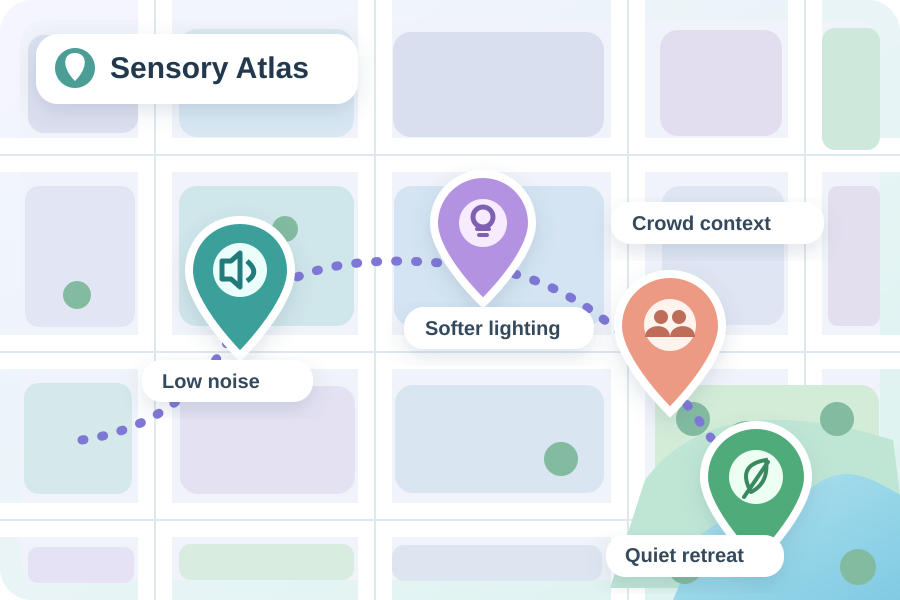
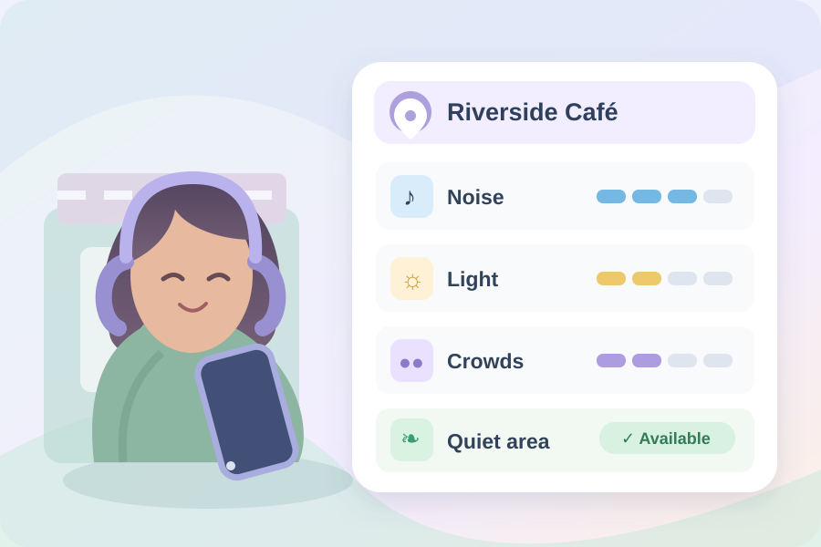

<div align="center">
  

  # Sensory Atlas

  **Making public spaces more accessible, one experience at a time.**

  *Accessibility beyond physical barriers.*

  [Explore the concept website](https://orpheane.github.io/Sensory-Atlas/) · [The vision](#the-vision) · [Interactive concept](#interactive-concept) · [Roadmap](#roadmap)

   
</div>

> **Project status:** Sensory Atlas is an early-stage **Ideathon concept**. This repository includes a project showcase and a small interactive illustration. It is **not** a working location database, a live map, or a verified sensory accessibility service. All places and ratings in the demo are fictional.

## The vision

As a neurodivergent woman, I know that a place can be physically accessible and still feel overwhelming. Bright lights, unexpected sounds, crowded rooms, and uncertainty can make everyday outings exhausting.

**Why can we check whether a building has an elevator, but not whether its lighting, noise, or crowds might overwhelm us?**

Sensory Atlas imagines a collaborative map where people can learn more about the **sensory characteristics of public spaces** before deciding where and when to go.

The goal isn't to give every place a universal score. It is to help people make informed choices based on **their own needs**.

## The proposed experience

| Feature | Purpose |
| :--- | :--- |
| Interactive sensory map | Discover places with information about sound, lighting, crowds, and quiet spaces. |
| Personal sensory preferences | Choose which factors matter most to you, without sharing a diagnosis. |
| Community observations | Read different perspectives and see when information was collected. |
| Quieter-time discovery | Explore potentially calmer visiting times where reliable information exists. |
| Sensory-friendly planning | Prepare for outings with more context and fewer surprises. |

## Interactive concept

The [concept website](https://orpheane.github.io/Sensory-Atlas/) includes a small interactive example:

1. Choose the maximum level of noise, lighting, and crowding that feels comfortable.
2. Explore how fictional venues can be sorted by whether they fit those preferences.
3. See why a personalized result can be more meaningful than a single universal place rating.

**Important limitations:** The example uses invented places and simplified 1-5 values. It does not use real-world geographic data, actual observations, real-time occupancy, live environmental measurements, or medical recommendations. It does not store individual preferences.

### Early visual exploration

<table><tr><td width="50%"></td><td width="50%"></td></tr></table>

*These are AI-assisted concept illustrations, not screenshots from a working product.*

## Why it matters

Information about physical accessibility is valuable, but it doesn't tell the whole story. Sensory considerations can be especially useful to autistic people, people with ADHD, people with migraine or sensory processing differences, and anyone who benefits from predictable surroundings.

**Accessibility isn't only about entering a space. It is also about being able to experience it.**

## Design principles

- **Individual choice:** Different sensory preferences are valid. Avoid one-size-fits-all suitability claims.
- **Community context:** Keep observations dated, distinguish personal experiences from measurements, and clearly show gaps.
- **Privacy:** Avoid requiring diagnoses, protect contributors, and make location permission optional.
- **Accessibility:** Support keyboard navigation, reduced motion, readable text, and a non-map way of accessing information.
- **Transparency:** Do not present fictional examples or speculative information as verified real-world data.

## Roadmap

- [x] Define the problem and initial concept
- [x] Develop an initial visual identity
- [x] Prepare a static showcase and interactive **fictional** example for publication
- [ ] Gather feedback from neurodivergent and sensory-sensitive people
- [ ] Prototype accessible place-search and map views
- [ ] Define community moderation, verification, and data freshness rules
- [ ] Build an MVP backed by real places and consent-aware submissions
- [ ] Test with a small local pilot before expanding

See [the longer roadmap](docs/ROADMAP.md) and [privacy and accessibility principles](docs/PRINCIPLES.md).

## Technology

**Used for this GitHub showcase:** HTML, CSS, and vanilla JavaScript. The concept illustrations were generated with AI assistance; the written concept was developed with AI-assisted drafting support.

**Possible future application stack (not implemented):** React, TypeScript, Vite, MapLibre GL JS, OpenStreetMap-compatible geodata, Supabase, PostgreSQL, and PostGIS. These choices will be evaluated against accessibility, costs, privacy, and service terms before development.

## Run locally

This showcase has **no build step or external JavaScript dependencies**. Open `index.html` in a browser, or serve it locally:

```bash
python -m http.server 8000
```

Then open `http://localhost:8000/`.

## Deploy on GitHub Pages

In the public `Orpheane/Sensory-Atlas` repository, publish the site files in the repository root and enable **Settings → Pages → Deploy from a branch → main → /(root)**. The site will be available at:

`https://orpheane.github.io/Sensory-Atlas/`

The site and links above are intended targets; they are not live until Pages is enabled and deployed.

## Project origin

Sensory Atlas was conceived for the **STEMergent Hacks 2026 Ideathon**, starting from firsthand neurodivergent experiences and the question of how we can make invisible barriers easier to anticipate.

Created by [Orpheane](https://github.com/Orpheane).

---

*Because everyone deserves the freedom to explore the world at their own comfort level.*

**License:** No open-source license has been selected yet. Please do not assume permission to reuse the repository's content or graphics.